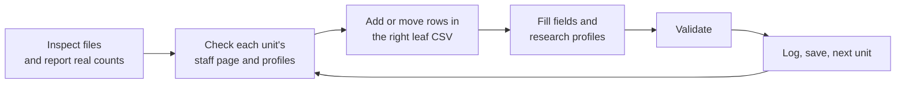

# Continue collecting Lanka Academia data

Continue from the existing `Data/Lanka-Academia/` folder. Keep every existing ID and piece of evidence; do not restart. Count the real records instead of trusting any older figure.

## Boundaries

- Work only in `Data/Lanka-Academia/` (and a separate export for the ZIP). Do not edit `src/`, `public/`, `scripts/`, config, screenshots or deployment files, and do not push or deploy.
- Internal evidence and review files stay private (git-ignored). See [PRIVACY_SAFEGUARDS.md](PRIVACY_SAFEGUARDS.md).
- Save after each faculty or department. Keep checkpoint, source, access-issue, review, unresolved-field, coverage and change logs.

## Scope

Colombo, Peradeniya, Sri Jayewardenepura, Kelaniya, Moratuwa, Jaffna, Ruhuna, KDU, SLIIT, NSBM, CINEC, Horizon, KIU, ICBT and Uva Wellassa. Not Saegis. Use the exact names and IDs in `universities.csv`. Do not call an institution complete until every unit has been checked.

## Where a person goes

| Rule | Detail |
|---|---|
| Path | `universities/<id>/faculties/<faculty>/[departments/<department>/]academics.csv` |
| One row per person | One active CSV only. Faculty CSVs hold people with no documented department. |
| Names and slugs | Keep published names in the CSV; slugs are lowercase-hyphenated; reuse existing folders. |
| Headers and IDs | Copy the header from an existing file. Keep existing IDs. New IDs are stable and collision-free. |
| Moves | Move the row, never duplicate it; log the change. Do not merge ambiguous names. |

## Who to add

- Current permanent or full-time staff. Put visiting, honorary, adjunct, retired, temporary or uncertain staff in `employment_review.csv`.
- Do not infer employment, gender, age, qualifications or experience from a name, photo or title.
- Priority: KIU and ICBT.

## What to collect

| Field | Rule |
|---|---|
| Identity and position | Name, institution, faculty, department, position as published |
| Qualifications and PhD | PhD institution, country and year only when completed. "Dr" and ongoing PhDs are not evidence. Never substitute a master's university. |
| Experience | Only from a dated employment history, with the calculation recorded |
| Research profiles | Scholar first (official link, else verify affiliation and field), ResearchGate as a labelled backup, OpenAlex when the identity is verified |
| Metrics | Citations, citations received in calendar years 2021–2025, h-index, publications. Never mix providers; keep each source's date. |
| Unknown vs zero | Unreachable or unknown stays blank. Zero needs evidence. |
| Publications | `publication_details.csv`: title, authors, year, venue, DOI, type, source URL, citations, quartile evidence. De-duplicate by DOI, then title and year. |
| Q1 | Journal articles only, one documented quartile source, classified by publication year. Partial counts are stored separately and never presented as totals (see `q1_methodology.md`). |

## Corrections and access

Change a value only with stronger evidence, and log the old value, new value, source, date and reason. Respect access limits, CAPTCHAs and rate limits. Never fabricate a field.

## Validate before handoff

Headers identical, IDs unique, institution names and IDs valid, numbers numeric, links well formed, publications de-duplicated, units match the inventories. Count only active leaf records, not archives or evidence rows.

## Deliver

The updated `Data/Lanka-Academia/` folder and a ZIP with the same structure, plus a short handoff: records added or corrected, verified research profiles, metric completeness, units checked and units pending. The app developer runs `npm run data:import` and deploys.
