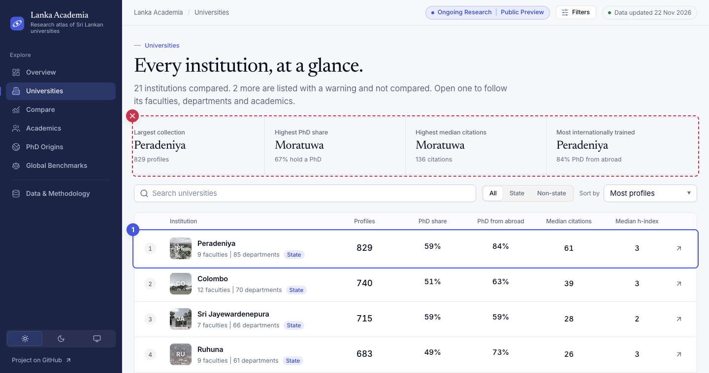
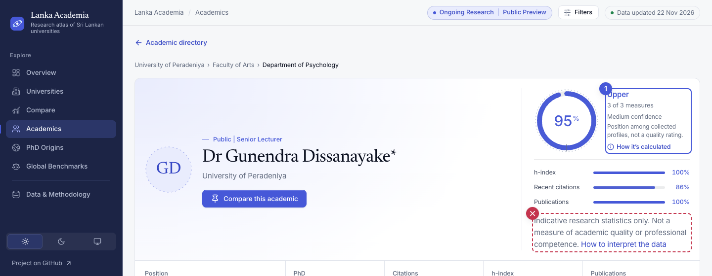
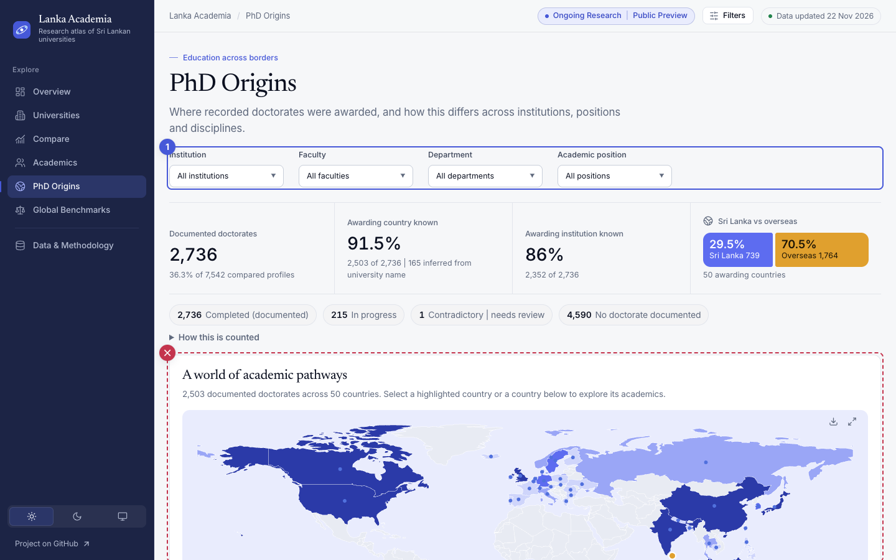

# How to interpret the data

Lanka Academia presents indicative research information, not judgments about academic quality. Details: [STANDING_SCORE.md](STANDING_SCORE.md), [DATA_POLICY.md](DATA_POLICY.md), [legal/PRIVACY.md](legal/PRIVACY.md).

## 1. Purpose

An independent, descriptive overview of academic capacity in Sri Lanka, compiled from public university staff pages and public research indexes (OpenAlex, Google Scholar, ResearchGate). It is a **partial set of published profiles**, not a staff census, and not an official source.

## 2. What the numbers mean

- **Publications:** outputs recorded by a source. Volume, not importance.
- **Citations:** times those outputs are cited in that source. Recent citations cover 2021 to 2025.
- **h-index:** the largest *h* with *h* outputs each cited at least *h* times. It tends to rise with career length.

Sources count differently, so values from different sources are never combined.

## 3. Reading the outputs

Three examples. Blue boxes show what a figure describes; the red dashed cross marks what it must not be read as.

### Universities table

- **✓ Means:** the figures describe the profiles collected for each institution. A dash means too few values to show a figure.
- **✕ Does not mean:** the highlights are not a league table. "Highest PhD share" or "most cited" does not make an institution better, and a small collection is not a small staff.
- **What to do:** read each figure with its profile count and coverage, and remember that a difference between two people shows recorded activity, not who is better.

### Research standing on a profile

- **✓ Means:** the person's position among comparable collected profiles on h-index, recent citations and publications, with a confidence label.
- **✕ Does not mean:** quality, competence, teaching or suitability. A high or low score is not a verdict on the person.
- **What to do:** open "How it's calculated", check the peer group and confidence, and open the original sources before using it anywhere.

### PhD origins

- **✓ Means:** where recorded doctorates were awarded, among profiles that document it.
- **✕ Does not mean:** that a country or university makes anyone more or less capable, or where the person studied or works now.
- **What to do:** treat it as background, and check how many records have a known country under "How this is counted".

## 4. How the research standing score works

A 0 to 100 **weighted blend of percentiles** among comparable collected profiles (`src/analytics/standing-score.ts`, full method in [STANDING_SCORE.md](STANDING_SCORE.md)).

1. Each measure is ranked within a same-source peer group: `100 × (below + ½ ties) ÷ peers`.
2. Percentiles are blended: h-index 40%, citations 2021 to 2025 35%, publications 25%. Missing measures are skipped and the weights rescaled.
3. Fixed bands: 80+ Upper, 60+ High-Mid, 40+ Middle, 20+ Low-Mid, below 20 Lower.

Standard peers share career stage and broad discipline (10+ peers per measure, 2+ measures including h-index or recent citations). Otherwise the score is labelled **indicative**, with low confidence, or not given. The weights are project assumptions, and the three measures overlap.

## 5. Metrics are not quality

They describe recorded research activity. They say nothing direct about teaching, supervision, service, practice, originality or competence.

## 6. Why comparisons can mislead

- **Discipline:** citation habits differ widely between fields.
- **Career stage:** longer careers accumulate more. Job title is a rough proxy.
- **Coverage:** sources index different journals, books and languages.
- **Records:** profiles may be missing, outdated or matched to the wrong person.

## 7. Missing is not zero

A blank means unknown, not zero output or no qualification. Missing measures are skipped. A doctorate counts as completed only with explicit evidence.

## 8. Doctorate country and university

Background only. They show where a doctorate was awarded, not where the person studied, and say nothing about competence.

## 9. Appropriate use and limits

Lanka Academia supports descriptive exploration of publicly available academic and research information. Individual indicators may be compared to see differences in recorded research activity, within the limits of the data and method.

- **Comparisons do not show** that one academic is better, more capable or more professionally suitable than another.
- **Not for decisions.** The indicators are not designed or validated for recruitment, promotion, funding, disciplinary or other decisions affecting individuals. Such decisions need independent, appropriate and comprehensive assessment. See [DATA_POLICY.md](DATA_POLICY.md) for reuse.

## 10. Verify and validate before any use

If you still need to rely on a figure, first:

1. Open the original source linked on the profile and confirm the person, the position and the value.
2. Check the source, retrieval date, peer group and confidence label shown with the figure.
3. Confirm the record is current and belongs to the right person (names can be shared; profiles can be mismatched).
4. Treat a missing value as unknown, never as zero or as a missing qualification.
5. Ask the person concerned, or their institution, where a decision would affect them.

## 11. Corrections and removal

Academics can request a correction or removal. Removal needs no reason. Corrections need the profile link, the field and an official source. Contact routes and the 14-day target for acknowledging requests are in [legal/PRIVACY.md](legal/PRIVACY.md) (section 7).

## 12. Our position on accuracy

- Lanka Academia compiles information that is already public, with the source and retrieval date recorded. It is a partial collection and not an official record.
- It is provided in good faith and "as is", without warranty (see [legal/NOTICE.md](legal/NOTICE.md)). Values can be missing, outdated or wrongly matched.
- Values are never invented or filled by guesswork. Unknown stays unknown, and each figure shows its source, sample size and coverage so it can be checked.
- It does not assess any person's quality, competence or suitability, and it is not endorsed by any institution. The research standing figure is a descriptive position among collected profiles only.
- If you believe a record is wrong or affects you unfairly, use the correction or removal route above. We acknowledge requests within the target time and act on verified ones.
- Ethics and data practice: [legal/ETHICS_AND_DATA.md](legal/ETHICS_AND_DATA.md).
