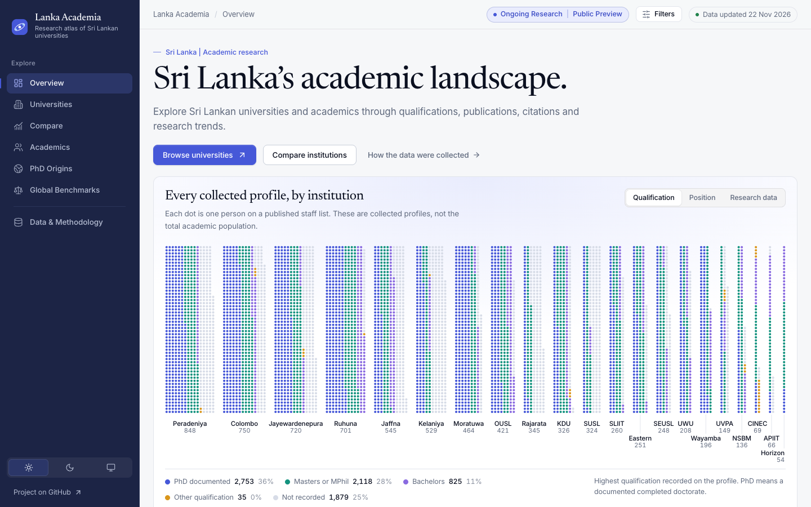
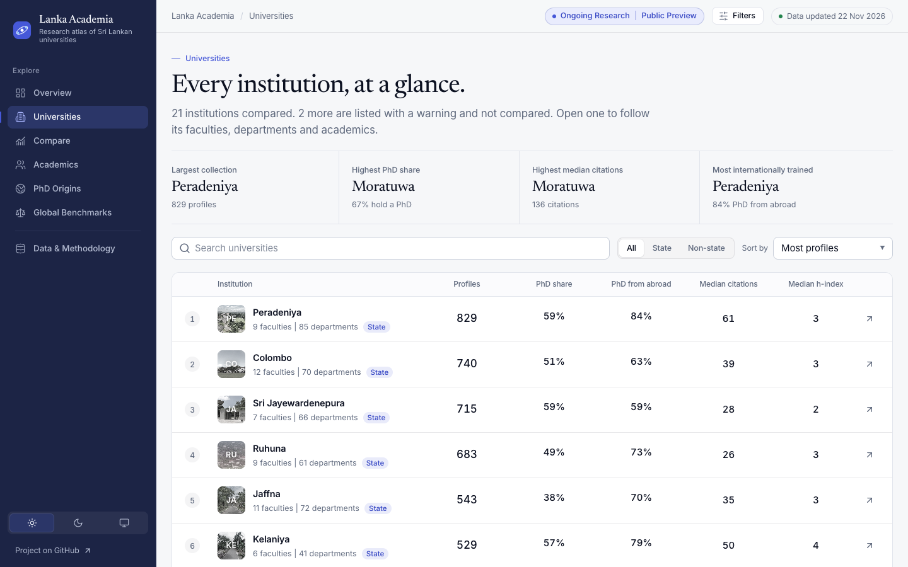
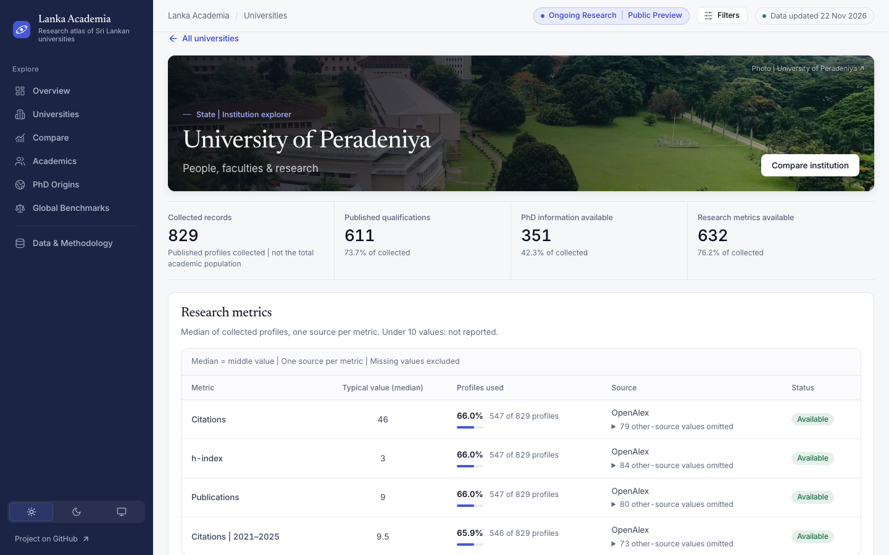
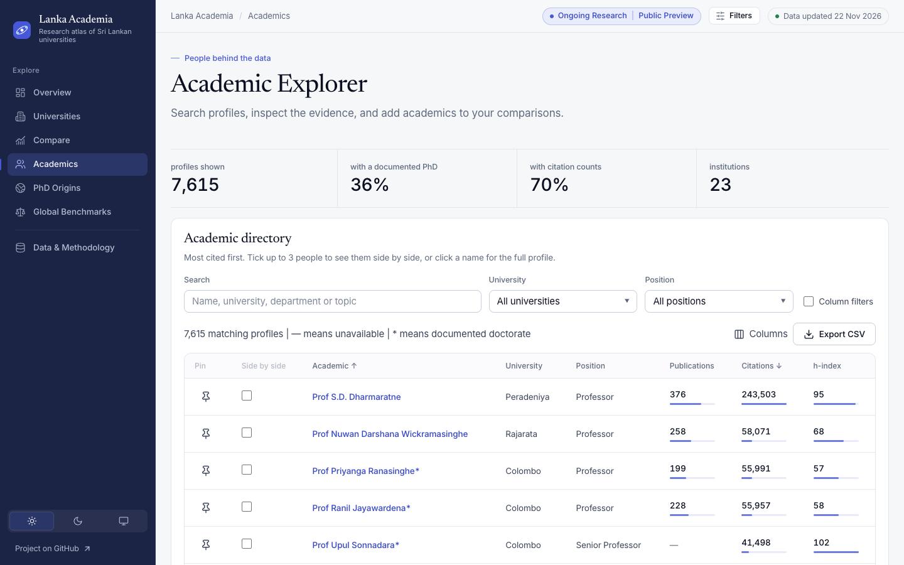
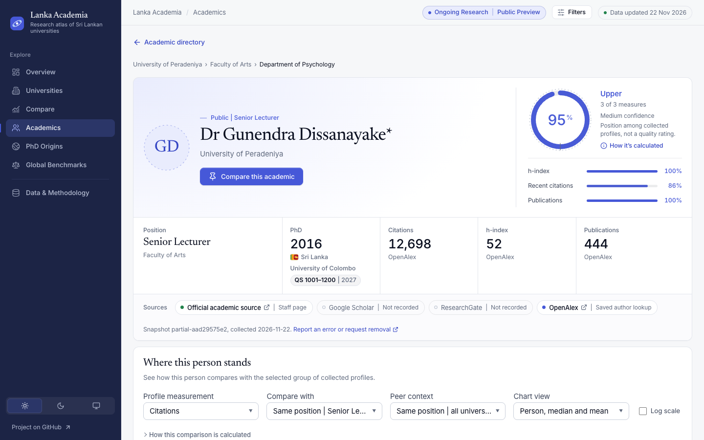
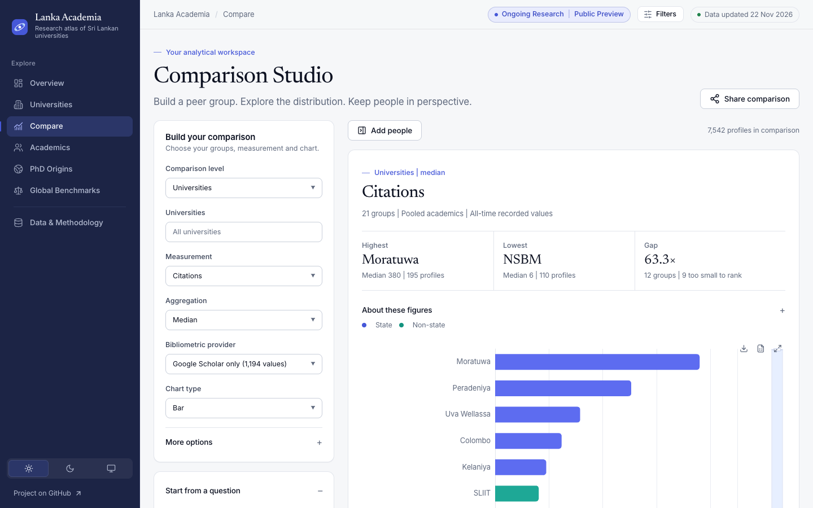
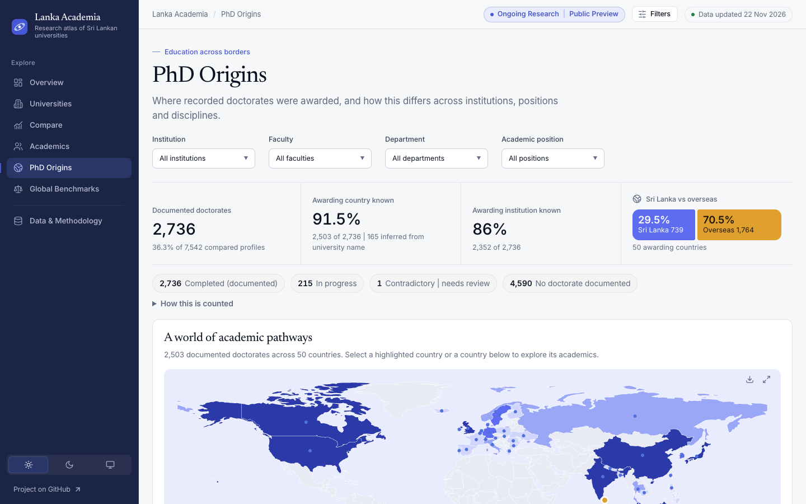
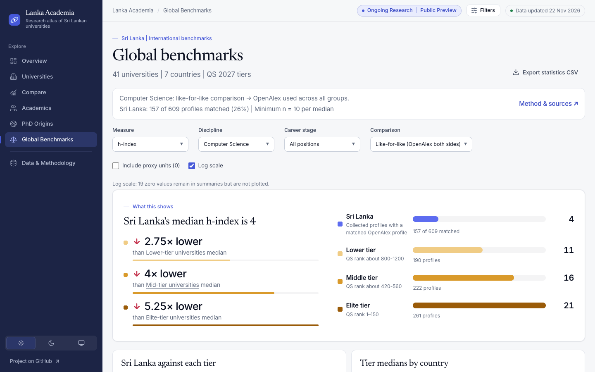
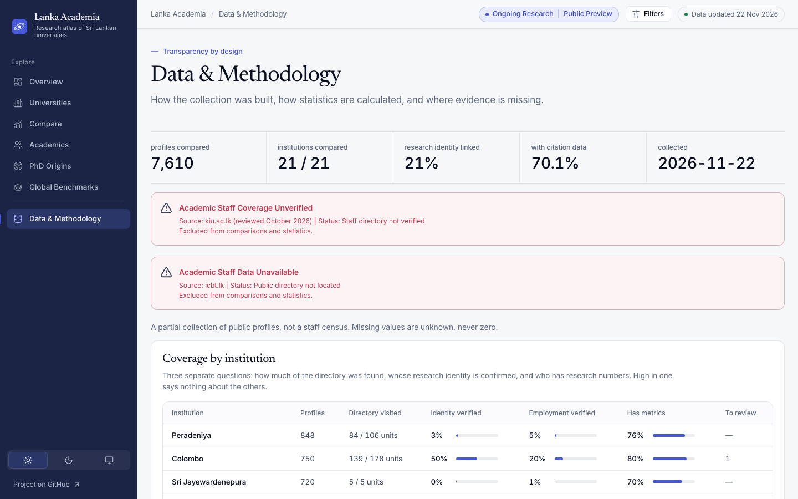
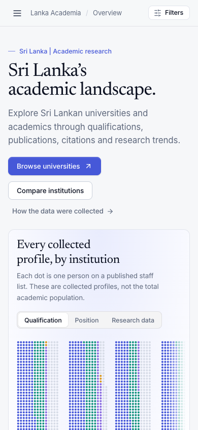

<!-- Generated from App/README.md by `npm run data:import`. Edit App/README.md, not this file. -->
<div align="center">

# Lanka Academia

**Explore Sri Lanka's academic landscape through research metrics, institutional comparisons, and interactive insights.**

`Ongoing Research | Public Preview`

[**Open the app**](https://maninka123.github.io/academic-lens-lk/) | [Documentation](App/docs/PROJECT_GUIDE.md) | [How to interpret the data](App/docs/HOW_TO_INTERPRET_DATA.md) | [Dataset guide](Data/Lanka-Academia/README.md) | [Report a correction](https://github.com/maninka123/academic-lens-lk/issues/new/choose)

  

</div>

<!-- dataset-summary:start -->
<!-- Snapshot partial-fcce4a0b91 -->
<p align="center"><strong>7,547 Sri Lankan profiles | 23 institutions | 1,774 international benchmark profiles.</strong><br><sub>Partial collection, updated 2026-11-22. <a href="App/reports/validation-report.md">Coverage report</a>.</sub></p>
<!-- dataset-summary:end -->

## Screenshots

Light theme shown unless marked. All pages also have a dark theme (sidebar switch) and work on phone and desktop.



| Universities | Institution page |
|---|---|
|  |  |

| Academics | Academic profile and research standing |
|---|---|
|  |  |

| Compare | PhD origins |
|---|---|
|  |  |

| Global benchmarks | Data and methodology |
|---|---|
|  |  |

| Dark theme | Mobile |
|---|---|
|  |  |

## What you can do

| | |
|---|---|
| **Universities** | A card per institution: profiles, PhD share, PhD from abroad, median citations and h-index. |
| **Academics** | Search profiles, view up to three people side by side, and download a profile report (PDF) or its data (CSV). |
| **Research standing** | An indicative 0-100 research-metric indicator based on weighted percentiles within available peer groups. See [the calculation and its limitations](App/docs/STANDING_SCORE.md). |
| **Compare** | Build your own comparisons across universities, faculties, departments, positions and PhD countries. |
| **PhD origins** | Where doctorates were awarded and how that differs by institution, position and discipline. |
| **Global benchmarks** | Sri Lanka against elite, middle and lower QS-ranked universities in seven countries, by discipline and seniority. |
| **Light and dark** | One design system across every page, chart, popup and drawer; light, dark or follow the device. |

## Repository layout

| Path | What is in it |
|---|---|
| `App/` | The web app: `src/`, `public/` (generated site data), `scripts/` (import, metrics, checks), `tests/`, `design-system/`, `package.json` |
| `Data/Lanka-Academia/` | The single authoritative dataset: one CSV per department, plus rankings and review files (evidence stays git-ignored) |
| `App/docs/` | Guides, policies and legal notices (`App/docs/legal/`), workflows and screenshots |
| `.github/` | CI workflow, issue forms and `SECURITY.md` (private-request guide) |
| `App/reports/` | Generated coverage and validation reports |
| `private/` | Local only, never committed (API keys, ethics documents) |

## Run locally

Node.js 22.12 or newer. No backend is needed.

```sh
cd App
npm ci
npm run dev        # http://localhost:5173/academic-lens-lk/
```

| Task | Command |
|---|---|
| Re-import data after editing the CSVs in `Data/Lanka-Academia/` | `npm run data:import` |
| Type-check, unit and script tests | `npm test` |
| Production build | `npm run build` |
| End-to-end tests | `npm run test:e2e` |


## How the data works

- **Missing stays missing.** An unknown value is never treated as zero.
- **Comparisons show their source, sample size and coverage where available.** Citation counts are not a measure of academic quality.
- **Adding people:** list pages give names and positions; each person's own profile page gives their Google Scholar and ResearchGate links, which are then used for metrics before any name search. Metrics come from OpenAlex and, for linked profiles, Google Scholar via a quota-first [pipeline](App/scripts/scholar_scraper/README.md).
- **Titles:** **Prof** for documented professorial positions, otherwise **Dr** for a completed research doctorate.
- **Asterisk (\*)** marks a documented completed research doctorate. A medical qualification alone does not count.
- **Research standing:** [methodology](App/docs/STANDING_SCORE.md) | **Yearly citations:** [how to add them](App/docs/SCHOLAR_YEARLY.md)

More: [Methodology & setup](App/docs/PROJECT_GUIDE.md) | [How to interpret the data](App/docs/HOW_TO_INTERPRET_DATA.md) | [Data policy](App/docs/DATA_POLICY.md) | [Collection prompt](App/docs/DATA_COLLECTION_PROMPT.md) | [Two workflows](App/docs/WORKFLOWS.md) | [Record counts](App/docs/DATA_COUNTS.md)

## Global benchmark method

Research comparisons use matched OpenAlex profiles on both sides, with Computer Science and Physics selected by default. Selected Medicine, Engineering, Law, Management and Business profiles are also included; their unverified metrics stay blank. [Dataset details](Data/Lanka-Academia/international/README.md).

<details>
<summary>Method, sampling and substitutions</summary>

- QS World University Rankings 2027, published 18 June 2026. Each country contributes two elite universities (QS 2027 top 150, the two highest-ranked with accessible directories), two middle-tier universities (~420-560) and two lower-tier universities (~800-1200). Australia has one lower-tier sample because other directories blocked access.
- Official staff directories exclude visiting, adjunct, courtesy and emeritus roles. Departments larger than 25 are sampled systematically in directory order. These are samples, not national censuses.
- OpenAlex matches require name and institution agreement. Ambiguous or implausibly merged profiles remain blank; lookup attempts are not matches. Groups need at least 10 valid values to report a median.
- Use the career-stage control to compare similar positions. Elite samples often contain more professors than Sri Lankan directories.
- Data and source rosters: [international dataset](Data/Lanka-Academia/international/). Build scripts: [scripts/baselines](App/scripts/baselines/).

### Substitutions

Where a first-choice university's directory was unreachable, the next university in the same band was used. Each substitution and its reason is recorded in the international `universities.csv` (`substitution_note`).

</details>

## Please note

> [!IMPORTANT]
> This project uses only publicly available information. The data is a **partial collection**, may be incomplete, outdated or wrong, and is **not** an assessment of any individual. Verify details with the original sources. Anyone named here can ask for a correction or removal, without giving a reason: [open a request](https://github.com/maninka123/academic-lens-lk/issues/new/choose).

## Acknowledgements

Map boundaries: [Natural Earth / world-atlas](https://github.com/topojson/world-atlas) | Research indexes: [OpenAlex](https://openalex.org) | University rankings: QS World University Rankings 2027 | Flag icons: [country-flag-icons](https://github.com/catamphetamine/country-flag-icons) | Campus photographs are credited to their owners in [docs/CAMPUS_IMAGES.md](App/docs/CAMPUS_IMAGES.md).

## Licence

| | |
|---|---|
| **Code** | [MIT](LICENSE) |
| **Aggregate statistics and reports** | [CC BY 4.0](App/docs/legal/DATA_LICENSE.md): free to use with credit. Individual records are excluded from this licence. |
| **Notice** | [Data may be wrong, no warranty, third-party material](App/docs/legal/NOTICE.md) |
| **Privacy and data use** | [Privacy Notice](App/docs/legal/PRIVACY.md): what is collected, why and how long it is kept |
| **Ethics and data statement** | [ETHICS_AND_DATA.md](App/docs/legal/ETHICS_AND_DATA.md) |

Copyright (c) 2026 Pasindu Ranasinghe.
