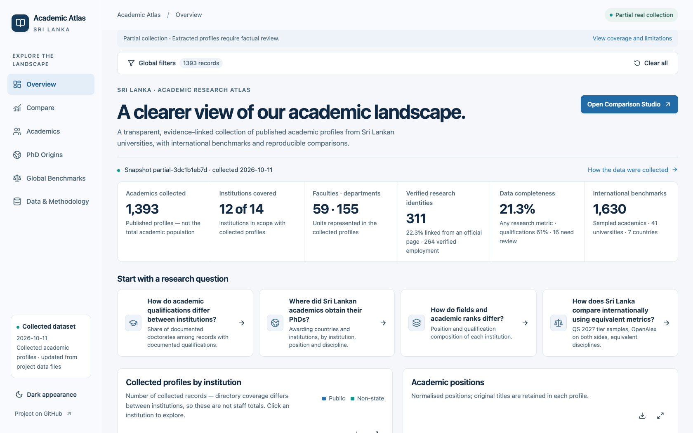
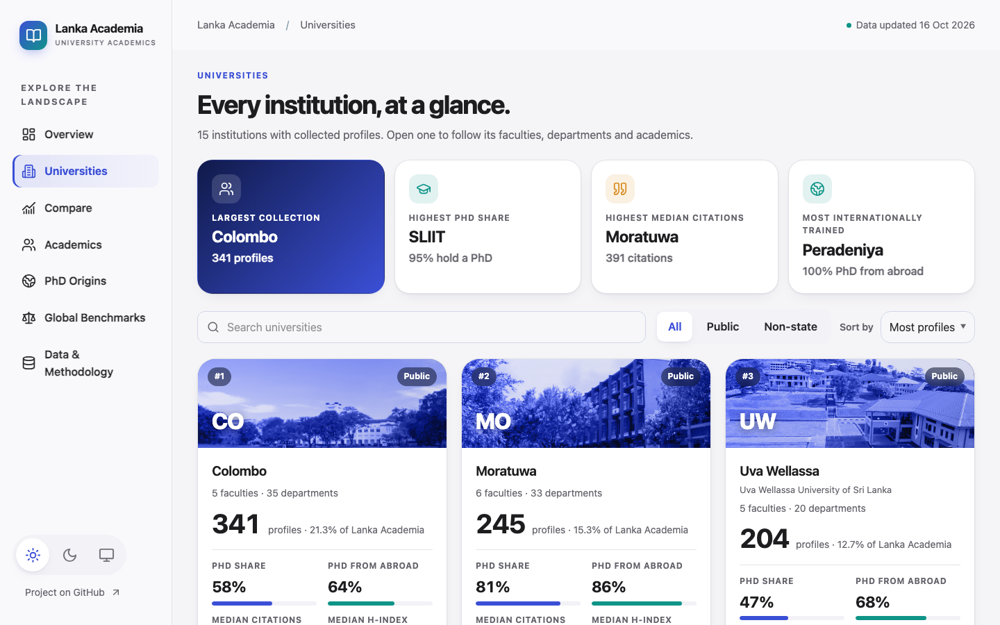
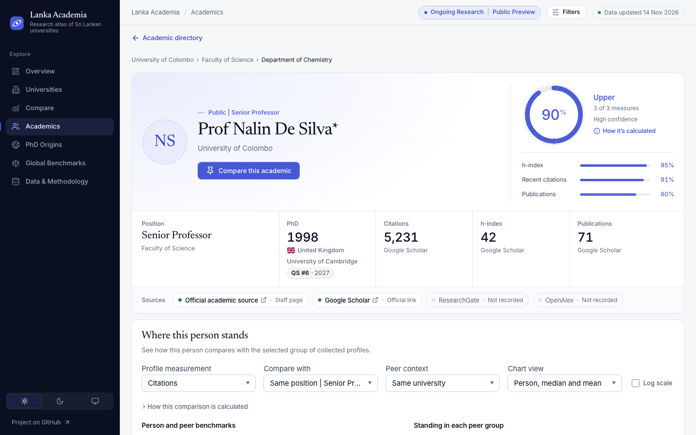
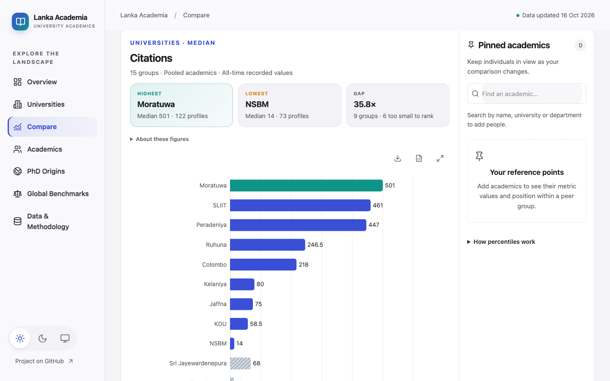
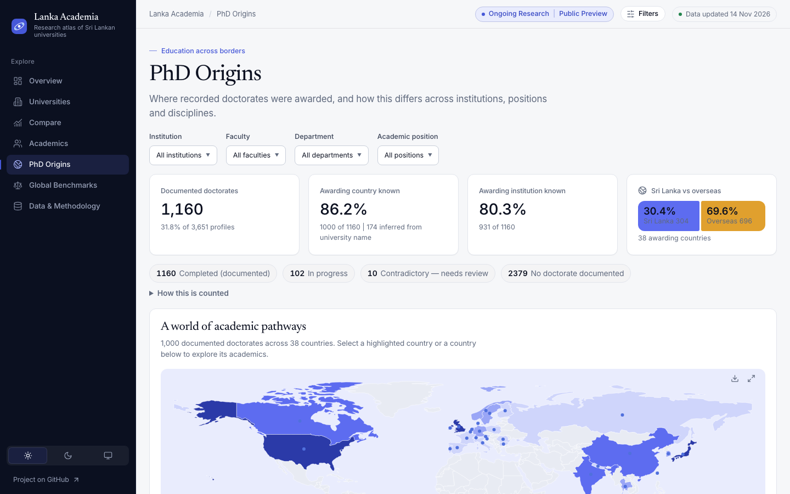
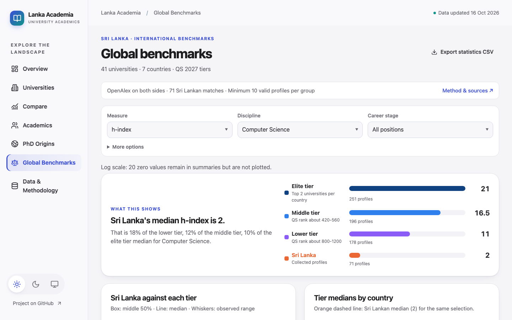
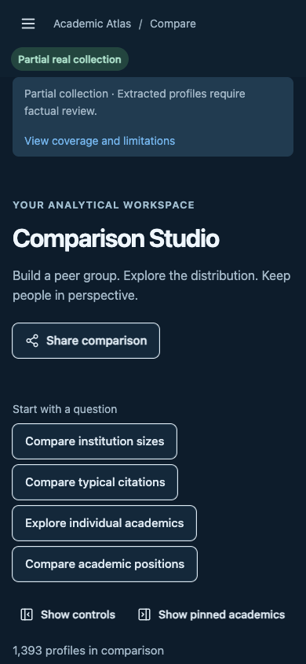

<div align="center">

# Lanka Academia

**Explore who teaches and researches at Sri Lankan universities, how they compare, and where their PhDs were awarded.**

`Ongoing Research | Public Preview`

[**Open the app**](https://maninka123.github.io/academic-lens-lk/) | [Documentation](docs/PROJECT_GUIDE.md) | [Dataset guide](Data%20files/README.md) | [Report a correction](https://github.com/maninka123/academic-lens-lk/issues/new/choose)

  

</div>

<!-- dataset-summary:start -->
<!-- Snapshot partial-8f653c9b68 -->
**3,325 Sri Lankan profiles | 15 institutions | 1,740 international benchmark profiles.** Partial collection, updated 2026-10-20. [Coverage report](reports/validation-report.md).
<!-- dataset-summary:end -->

## Screenshots



| Universities | Academic profile and research standing |
|---|---|
|  |  |

| Compare | PhD origins |
|---|---|
|  |  |

| Global benchmarks | Mobile |
|---|---|
|  |  |

## What you can do

| | |
|---|---|
| **Universities** | A card per institution: profiles, PhD share, PhD from abroad, median citations and h-index. |
| **Academics** | Search profiles, view up to three people side by side, and download a profile report (PDF) or its data (CSV). |
| **Research standing** | A transparent 0-100% score showing where a person sits among comparable academics. Click it to see the calculation. |
| **Compare** | Build your own comparisons across universities, faculties, departments, positions and PhD countries. |
| **PhD origins** | Where doctorates were awarded and how that differs by institution, position and discipline. |
| **Global benchmarks** | Sri Lanka against elite, middle and lower QS-ranked universities in seven countries, by discipline and seniority. |

## Run locally

Node.js 22.12 or newer. No backend is needed.

```sh
npm ci
npm run dev        # http://localhost:5173/academic-lens-lk/
```

| Task | Command |
|---|---|
| Re-import data after editing the CSVs in `Data files/` | `npm run data:import` |
| Type-check, unit and script tests | `npm test` |
| Production build | `npm run build` |
| End-to-end tests | `npm run test:e2e` |


## How the data works

- **Missing stays missing.** An unknown value is never treated as zero.
- **Every comparison shows its source, sample size and coverage.** Citation counts are not a measure of academic quality.
- **Titles:** **Prof** for documented professorial positions, otherwise **Dr** for a completed research doctorate.
- **Asterisk (\*)** marks a documented completed research doctorate. A medical qualification alone does not count.
- **Research standing:** [how the score is calculated](docs/STANDING_SCORE.md) | **Yearly citations:** [how to add them](docs/SCHOLAR_YEARLY.md)

More: [Methodology & setup](docs/PROJECT_GUIDE.md) | [Data policy](docs/DATA_POLICY.md) | [Collection prompt](DATA_COLLECTION_PROMPT.md)

## Global benchmark method

Research comparisons use matched OpenAlex profiles on both sides, with Computer Science and Physics selected by default. Selected Medicine, Engineering, Law, Management and Business profiles are also included; their unverified metrics stay blank. [Dataset details](Data%20files/international/README.md).

<details>
<summary>Method, sampling and substitutions</summary>

- QS World University Rankings 2027, published 18 June 2026. Each country contributes two elite universities (top two with accessible directories), two middle-tier universities (~420-560) and two lower-tier universities (~800-1200). Australia has one lower-tier sample because other directories blocked access.
- Official staff directories exclude visiting, adjunct, courtesy and emeritus roles. Departments larger than 25 are sampled systematically in directory order. These are samples, not national censuses.
- OpenAlex matches require name and institution agreement. Ambiguous or implausibly merged profiles remain blank; lookup attempts are not matches. Groups need at least 10 valid values to report a median.
- Use the career-stage control to compare similar positions. Elite samples often contain more professors than Sri Lankan directories.
- Data and source rosters: [international dataset](Data%20files/international/). Build scripts: [scripts/baselines](scripts/baselines/).

### Substitutions

- **ANU** (Australia, elite): University of Melbourne (QS 22) directories return HTTP 403 to automated access; next-ranked ANU used
- **Murdoch** (Australia, middle): University of Canberra (QS 477) staff profiles return HTTP 403; Murdoch (same band) used. Murdoch 'our people' pages list ranked senior academics only
- **UniSC** (Australia, lower): Charles Sturt University (QS 951-1000) blocks automated access (HTTP 403); UniSC used. UniSC has no physics department: engineering academics used as nearest physical-science unit
- **IIT BHU** (India, middle): Anna University (QS 470) department sites unreachable (DNS/TLS failures); IIT BHU (same band, public) used
- **Bordeaux** (France, middle): Université de Montpellier (QS 473) has no static staff list (LIRMM directory is JavaScript-only); Bordeaux (same band) used
- **TU Chemnitz** (Germany, lower): Bielefeld University (QS 1001-1200) publishes no consolidated professor list (research-group pages only); TU Chemnitz (same band) used
- **CDU** (Australia, middle): Second middle-tier slot: University of Canberra, JCU, CQU and ECU block automated access; CDU (QS 551) used. CDU has no physics department, so only IT is sampled
- **IIT Indore** (India, middle): IIT Indore physics site returns HTTP 403; only CSE sampled
- **IIT Bhubaneswar** (India, lower): Aligarh Muslim University (same band) faculty pages are JavaScript-only; IIT Bhubaneswar used
- **Windsor** (Canada, middle): University of Guelph (QS 546) people directory is JavaScript-only; Windsor (QS 537) used
- **CY Cergy** (France, lower): Nantes Université (901-950) LS2N directory is AJAX-protected; CY Cergy (same band) used. LPTM physics lab publishes no member list; only computing (ETIS) sampled
- **Würzburg** (Germany, middle): Leipzig University (QS 540) physics institutes publish no professor lists; Würzburg (QS 430) used
- **Wuppertal** (Germany, lower): University of Oldenburg (same band) publishes no consolidated professor list; Wuppertal used

</details>

## Please note

> [!IMPORTANT]
> This project uses only publicly available information. The data is a **partial collection**, may be incomplete, outdated or wrong, and is **not** an assessment of any individual. Verify details with the original sources. Anyone named here can ask for a correction or removal, without giving a reason: [open a request](https://github.com/maninka123/academic-lens-lk/issues/new/choose).

## Acknowledgements

Map boundaries: [Natural Earth / world-atlas](https://github.com/topojson/world-atlas) | Research indexes: [OpenAlex](https://openalex.org) | University rankings: QS World University Rankings 2027 | Flag icons: [country-flag-icons](https://github.com/catamphetamine/country-flag-icons) | Campus photographs are credited to their owners in [docs/CAMPUS_IMAGES.md](docs/CAMPUS_IMAGES.md).

## Licence

| | |
|---|---|
| **Code** | [MIT](LICENSE) |
| **Aggregate statistics and reports** | [CC BY 4.0](DATA_LICENSE.md): free to use with credit. Individual records are excluded from this licence. |
| **Notice** | [Data may be wrong, no warranty, third-party material](NOTICE.md) |
| **Privacy and data use** | [PRIVACY.md](PRIVACY.md): what is collected, why and how long it is kept |
| **Ethics and data statement** | [ETHICS_AND_DATA.md](ETHICS_AND_DATA.md) |

Copyright (c) 2026 Pasindu Ranasinghe.
