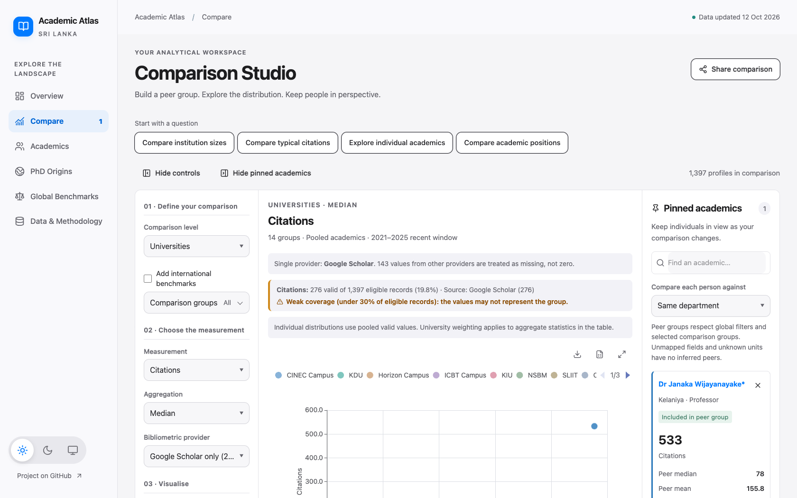
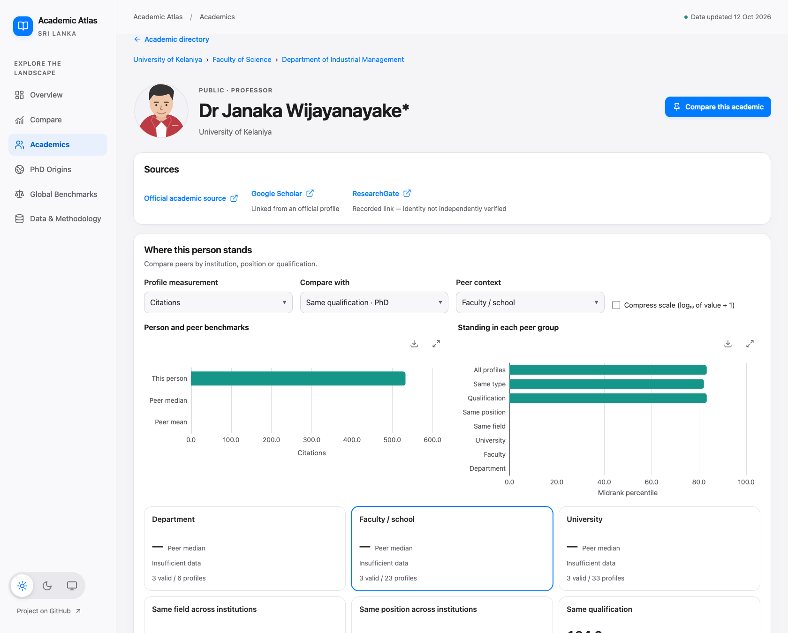
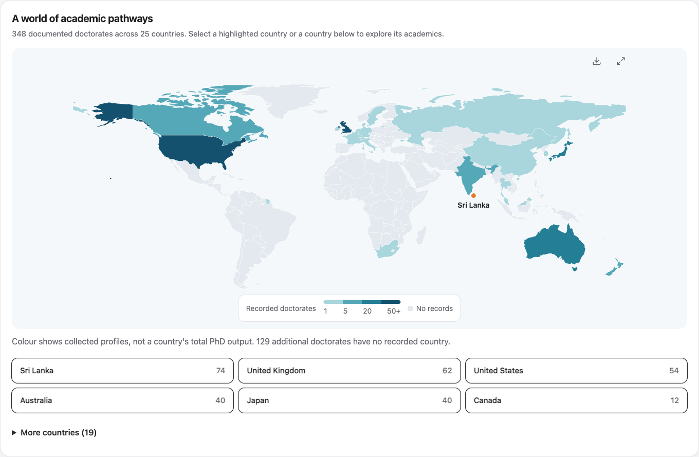
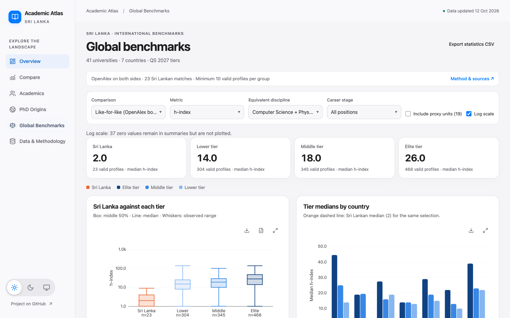

# Sri Lanka Academic Atlas

Explore academics, compare peer groups, and discover where their PhDs were awarded.

**[Open the app](https://maninka123.github.io/academic-lens-lk/)** · [Dataset guide](Data%20files/README.md) · [Full documentation](docs/PROJECT_GUIDE.md)

<!-- dataset-summary:start -->
<!-- Snapshot partial-92c4d4fa84 -->
**1,397 Sri Lankan profiles · 14 institutions · 1,740 international benchmark profiles.** Partial collection, updated 2026-10-12. [Coverage report](reports/validation-report.md).
<!-- dataset-summary:end -->

- Search people and inspect qualifications, research links and peer comparisons.
- Compare universities, faculties and departments; explore global benchmarks.
- Filter, pin, share and export. Desktop-first, mobile-friendly.

## Screenshots


| Compare academics | Individual profiles |
| --- | --- |
|  |  |

| PhD origins | Global benchmarks |
| --- | --- |
|  |  |

<details>
<summary>Mobile preview</summary>


</details>

## Run locally

Node.js 22.12+; no backend required.

```sh
npm ci
npm run dev
```

Edit the CSVs in `Data files/`, then run `npm run data:import`. Validate with `npm test` and `npm run build`.

## Data notes

Missing values stay missing. Comparisons show coverage and source information; citation counts are not a measure of overall academic quality. **Dr Name*** means a documented completed research doctorate; medical qualifications alone do not qualify under this display convention.

[Methodology & setup](docs/PROJECT_GUIDE.md) · [Data policy](docs/DATA_POLICY.md) · [Collection prompt](DATA_COLLECTION_PROMPT.md)

GitHub Pages releases: **Actions → Build, check and deploy GitHub Pages → Run workflow**. Map boundaries: [Natural Earth / world-atlas](https://github.com/topojson/world-atlas).

> [!NOTE]
> This project uses only publicly available information. Data may be incomplete, outdated or incorrect—please verify details with the original sources.

## Global benchmark method

Research comparisons use matched OpenAlex profiles on both sides, with Computer Science and Physics selected by default. Selected Medicine, Engineering, Law, Management and Business profiles are also included; their unverified metrics stay blank. [Dataset details](Data%20files/international/README.md).

<details>
<summary>Method, sampling and substitutions</summary>

- QS World University Rankings 2027, published 18 June 2026. Each country contributes two elite universities (top two with accessible directories), two middle-tier universities (~420–560) and two lower-tier universities (~800–1200). Australia has one lower-tier sample because other directories blocked access.
- Official staff directories exclude visiting, adjunct, courtesy and emeritus roles. Departments larger than 25 are sampled systematically in directory order. These are samples, not national censuses.
- OpenAlex matches require name and institution agreement. Ambiguous or implausibly merged profiles remain blank; lookup attempts are not matches. Groups need at least 10 valid values to report a median.
- Use the career-stage control to compare similar positions. Elite samples often contain more professors than Sri Lankan directories. No overall performance score is produced.
- Data and source rosters: [international dataset](Data%20files/international/). Build scripts: [scripts/baselines](scripts/baselines/).

### Substitutions

- **ANU** (Australia, elite): University of Melbourne (QS 22) directories return HTTP 403 to automated access; next-ranked ANU used
- **Murdoch** (Australia, middle): University of Canberra (QS 477) staff profiles return HTTP 403; Murdoch (same band) used. Murdoch 'our people' pages list ranked senior academics only
- **UniSC** (Australia, lower): Charles Sturt University (QS 951-1000) blocks automated access (HTTP 403); UniSC used. UniSC has no physics department: engineering academics used as nearest physical-science unit
- **IIT BHU** (India, middle): Anna University (QS 470) department sites unreachable (DNS/TLS failures); IIT BHU (same band, public) used
- **Bordeaux** (France, middle): Université de Montpellier (QS 473) has no static staff list (LIRMM directory is JavaScript-only); Bordeaux (same band) used
- **TU Chemnitz** (Germany, lower): Bielefeld University (QS 1001-1200) publishes no consolidated professor list (research-group pages only); TU Chemnitz (same band) used
- **CDU** (Australia, middle): Second middle-tier slot: University of Canberra, JCU, CQU and ECU block automated access; CDU (QS 551) used. CDU has no physics department, so only IT is sampled
- **IIT Indore** (India, middle): IIT Indore physics site returns HTTP 403; only CSE sampled
- **IIT Bhubaneswar** (India, lower): Aligarh Muslim University (same band) faculty pages are JavaScript-only; IIT Bhubaneswar used
- **Windsor** (Canada, middle): University of Guelph (QS 546) people directory is JavaScript-only; Windsor (QS 537) used
- **CY Cergy** (France, lower): Nantes Université (901-950) LS2N directory is AJAX-protected; CY Cergy (same band) used. LPTM physics lab publishes no member list; only computing (ETIS) sampled
- **Würzburg** (Germany, middle): Leipzig University (QS 540) physics institutes publish no professor lists; Würzburg (QS 430) used
- **Wuppertal** (Germany, lower): University of Oldenburg (same band) publishes no consolidated professor list; Wuppertal used

</details>
