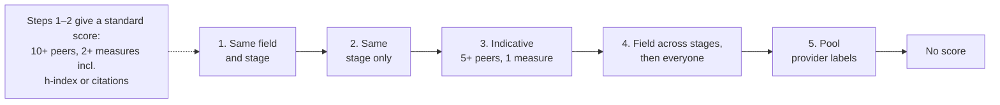
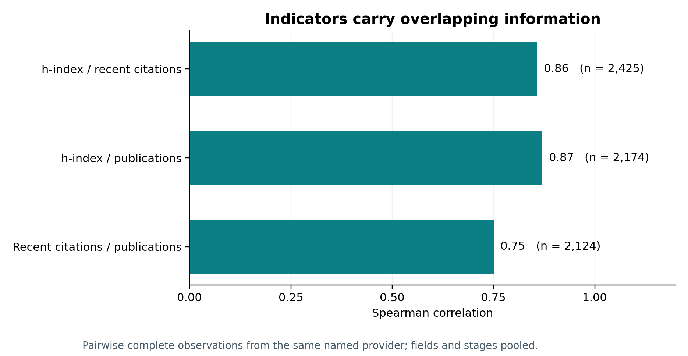
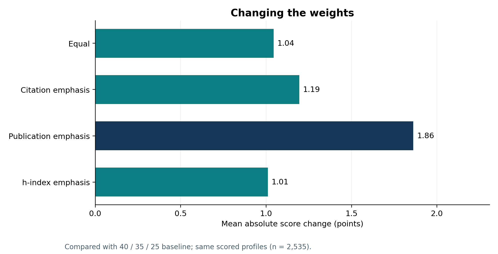

# Research standing score

A 0–100 **weighted blend of percentiles** that shows where a profile sits among collected Sri Lankan profiles. It is **not** a percentile of a combined score, and it does not measure research quality, teaching, service or merit.

[Main README](../README.md) · code: `src/analytics/standing-score.ts` · [validation study](../research/scoring-validation/README.md) · [methods](../research/scoring-validation/METHODOLOGY.md) · [results](../research/scoring-validation/RESULTS.md)

## How it is calculated

1. For each available measure, rank the person within a peer group: `percentile = 100 × (below + ½ tied) / n`. Peers must share the same data provider.
2. Take the weighted mean of those percentiles, rescaled over the measures present, and round.

| Measure | Weight | What it reflects |
|---|---:|---|
| h-index | 40% | accumulated citation-linked output |
| Citations 2021–2025 | 35% | recent citation activity |
| Publications | 25% | indexed output volume |

The weights are project assumptions, not scientific constants. A score of 50 is not necessarily the median score.

| Score | Label |
|---|---|
| 80–100 | Upper |
| 60–79 | High-Mid |
| 40–59 | Middle |
| 20–39 | Low-Mid |
| 0–19 | Lower |

Labels are fixed bands, not validated performance categories. Career stage (Professor, Mid-career, Early-career) comes from job title and discipline from a broad mapping; both are rough proxies.

## Missing data and fallbacks

Missing values are skipped, never treated as zero; a recorded zero counts. The app picks the first peer group that qualifies:

Each arrow means "if too few peers, try the next". Steps 3–5 give an **indicative** score, always low confidence.

**Known presentation issues** (documented, not changed): the across-stage fallback can say the stage was "not recognised" when it was known; stage-only scores may not say disciplines were mixed; matching provider labels does not prove comparable sources.

**Confidence** is a checklist, not a statistical interval. One point each for: field × stage group, all three measures, smallest pool ≥ 25, and a verified research identity. 4 = high, 2–3 = medium, else low. Stage-only is capped at medium; indicative is always low.

## Scientific basis

Publications, recent citations and h-index describe indexed output and citation activity, with limits from provider coverage, career length, field, document type and attribution. They cannot establish quality, originality, reputation or overall performance. The [Leiden Manifesto](https://doi.org/10.1038/520429a), [DORA guidance](https://sfdora.org/resource/guidance-on-the-responsible-use-of-quantitative-indicators-in-research-assessment/) and [OECD/JRC handbook](https://doi.org/10.1787/9789264043466-en) informed the design. None endorses this application or its weights.

## What the validation study found

Snapshot `partial-e191f13547`, code at commit `ab0ad8a`: 3,651 eligible records, 2,535 scored, 1,748 with no mapped discipline.

*The three measures overlap strongly (Spearman 0.75 to 0.87), so the weights double-count related information.*

*Alternative weightings keep overall ranks similar but move individual scores by up to 8–15 points and change 134–221 bands.*

Identity, provider and peer-group choices also changed coverage and results. None of this shows the score is valid, fair or optimally weighted.

## Use responsibly

Do not use the score alone to judge a person, for high-stakes decisions, or as a national or international ranking. The study recommends that any future named score verify each metric's identity, provider and dates, require enough comparable peers and complete inputs, and be withheld when field, stage or provenance is weak. These are proposals, **not implemented**. The algorithm, weights, labels and published scores are unchanged.
