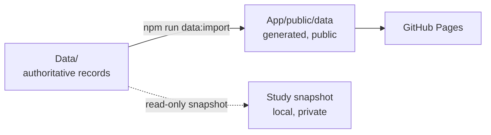

# Two workflows

| Folder | Role | In Git |
|---|---|---|
| `Data/` | Single authoritative dataset (evidence files are git-ignored) | Yes, except private evidence |
| `App/` | Website, import scripts, tests | Yes |
| `App/public/data/` | Generated copy for the site, never edited by hand | Yes |
| `International-Doctoral-Training-Study/` | Separate private research project | **Never** |

## Lanka Academia (GitHub-connected)
1. Edit records in `Data/`.
2. `cd App && npm run data:import`.
3. `npm test`, `npm run check:privacy`, `npm run build`.
4. Commit and push; GitHub Actions builds, checks privacy and deploys to `https://maninka123.github.io/academic-lens-lk/` (base path unchanged).
5. Confirm the Actions run is green.

Python tools (Scholar, OpenAlex) run from the repository root, for example `python3 App/scripts/scholar_scraper/scholar_pipeline.py --dry-run`. npm and Node scripts run from `App/`.

## Doctoral-training study (local only)
1. Update `Data/` through the normal workflow above first.
2. `python3 International-Doctoral-Training-Study/Scripts/create_snapshot.py` creates a new versioned snapshot. It never overwrites an earlier one and never writes to `Data/`.
3. `python3 International-Doctoral-Training-Study/Scripts/eligibility_audit.py` audits the latest snapshot.
4. Enrich in the study's own `Data/` folders only. Never write research columns back to `Data/`.
5. Nothing in the study folder is pushed. The folder is git-ignored and the privacy guard blocks it if it is force-added. The website does not read it and builds without it.
