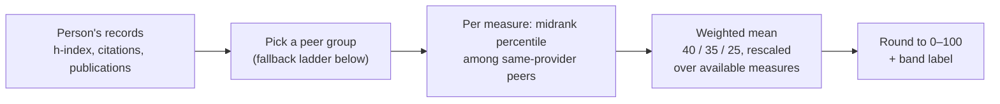
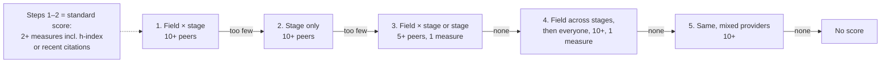
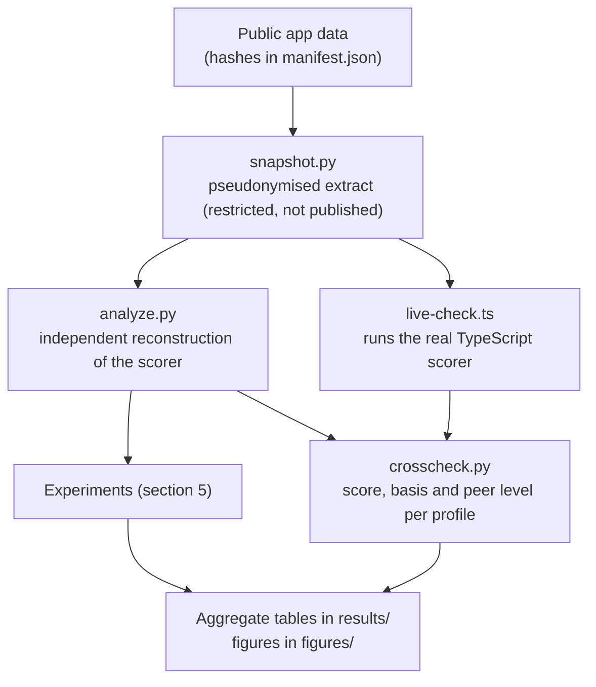

# Methodology

A public working paper by the project maintainer, separate from the scoring code. It is not an externally independent audit or a peer-reviewed study. Back to the [study README](README.md) · [results](RESULTS.md) · [limitations](LIMITATIONS.md) · [references](REFERENCES.md).

## 1. What is being measured

The score is meant to show **relative position in a selected collection of provider-specific publication and citation records**. It partly reflects output, recent citation activity and accumulated citation-linked influence.

| It is | It is not |
|---|---|
| A position within collected bibliometric records | Research quality, originality or reputation |
| A weighted blend of metric percentiles | A percentile of a composite score |
| A descriptive statistic | Teaching, service, societal impact or overall academic merit |

No external criterion in this dataset can validate the broader constructs.

## 2. The three indicators

| Indicator | Weight | Meaning | Main limits |
|---|---:|---|---|
| h-index ([Hirsch, 2005](REFERENCES.md)) | 40% | Output plus sustained citation activity | Cumulative; ignores citations above the threshold; depends on career length and field |
| Citations 2021–2025 | 35% | Recent citation activity | Can cite old work; self- and negative citations; provider and language coverage; fixed window |
| Publications | 25% | Indexed output volume | Ignores rigour and significance; depends on document types, coauthorship, coverage |

All three can be correlated. Choosing them is a project design decision, and the 40/35/25 weights are assumptions, not literature-derived or endorsed coefficients.

## 3. What the application actually does

Audited code: `src/analytics/standing-score.ts`, `quality.ts`, `engine.ts`, the data loader, `StandingScore.tsx`, `SideBySide.tsx`, `person-pdf.ts`, the methodology page and the current tests. Peers are the Sri Lankan collection after excluded institutions are removed, not the international benchmark.

**Percentile:** `100 × (number below + 0.5 × number tied) / n`. Ties include the person. The score is the weighted mean of these percentiles, so a score of 50 is not necessarily the median composite.

**Provider** is the first metric-level source, else the record-level source, mapped to Scholar, OpenAlex, ResearchGate, Mixed, Other or Not recorded. Matching labels do not prove matching coverage or dates, and "Not recorded" can match another unknown.

**Stage** comes from the title, not real career length: Professor and Senior Professor; Senior Lecturer and Associate Professor; Lecturer, Assistant Lecturer and Assistant Professor (Mid and Early career); all other titles unknown. **Field** follows academic → department → faculty → `Unmapped`. Both are rough proxies.

### Peer-group fallback ladder

Steps 3–5 give **indicative**, low-confidence scores. Publication-only scores are possible there. Across-stage fallback can occur even when the stage is known, yet the current caveat says it was not recognised; stage-only standard scores carry no dedicated mixed-discipline caveat.

**Confidence** (a heuristic, not an interval): one point each for field × stage, all three measures, smallest pool ≥ 25, and any verified Scholar or ResearchGate link or published OpenAlex URL. 4 = high, 2–3 = medium, else low. Stage-only is capped at medium; indicative is always low. A verified link does not prove each metric belongs to that identity.

## 4. Study design

The cross-check confirms the reconstruction matches the app on this snapshot (3,651 profiles, 0 mismatches). It does not test every edge case, the confidence output, or whether source identities are correct. Tests cover ties, zero, missingness, fallback and bands. The reconstruction groups before computing percentiles, includes the target, keeps real zeros and uses JavaScript-compatible rounding.

## 5. Experiments

Every run uses the same scored people unless stated. No values are imputed; missing is never zero.

| Experiment | What changes | How it is compared |
|---|---|---|
| Named weights | Equal, citation, publication, h-index emphasis | Same peer groups and component percentiles, reweighted |
| Weight grid | 0.1-step simplex, all weights positive (36 combinations) | Same as above |
| Complete case | Only people with all three measures | Targets and peers both restricted |
| Verified identity | Only the app's broad identity proxy | Targets and peers both restricted |
| Single provider | Google Scholar or OpenAlex only | Other providers discarded |
| Strict field × stage | No fallbacks, 2+ measures | Standard conditions only |
| Stage only | Force the broader group | Field ignored |
| Minimum 20 / 30 | Raise the standard threshold | The 5-person relaxed pass stays, so this is not a hard minimum |
| Tie rule | Upper empirical CDF instead of midrank | Ties get their upper rank |
| Outliers | Winsorise each pool at its 95th percentile | A sensitivity test, not evidence extremes are wrong |

**Statistics:** mean, median and maximum absolute score change; band changes after rounding; reversed pairs; Spearman ρ and Kendall τ-b (suited to skewed, tied scores). Differences use people scored in both scenarios. Correlations are pooled across fields, stages and providers, so they describe stability, not a valid global ranking. Indicator correlations use same-provider pairs only. Subgroups under 5 are suppressed. The only seed is `20261114`, used for the snapshot row shuffle; everything else is deterministic.

**These ranges are scenario ranges, not confidence intervals.** The sample is a non-probability collection, so no design-based error interval is claimed. Peer-sampling bootstrap and measurement-error models were not attempted because the error mechanisms are not established.

## 6. Data and provenance

- Input hashes, dataset label (`partial-e191f13547`), base commit, dirty-tree flag and excluded-institution count are in [manifest.json](data/manifest.json). The public data already had uncommitted changes, so the commit alone is not the snapshot.
- The record-level snapshot omits names, links, contact details and original IDs and has shuffled rows. It is **not published** because it is pseudonymised, not anonymous. Only aggregates are public.
- Duplicate screening counts repeated IDs, provider profile keys and normalised name + institution without exporting values. These are candidates, not confirmed duplicates.
- Dates are the source date of the first evidence per metric, or the collection date. Provider labels and dates are as recorded, not independently verified.

## 7. Recommendations

| # | Recommendation | Basis and consequence |
|---|---|---|
| 1 | Do not call it a composite percentile or overall quality; describe it as a blend of within-provider metric percentiles | Clarifies meaning without proving validity. Review app text and PDF before changing. |
| 2 | Withhold named scores in evaluative contexts and when identity, provider, metrics, peers, field or stage are weak | Coverage falls sharply: strict field × stage keeps 1,267 profiles, before identity safeguards. |
| 3 | Require verified identity for each component's source, comparable dated windows and all three components | Judgement, not empirically calibrated. Check duplicate keys first. |
| 4 | Revisit discipline granularity, the stage proxy and minimum sizes with domain experts | Raising a threshold while keeping fallback is not enough. Report peer composition. |
| 5 | Keep 40/35/25 only as a provisional research baseline | Ranks are stable overall but individuals move and indicators overlap. No evidence supports an optimum. |
| 6 | Fix the fallback caveat and the "50% typical" wording; consider removing mixed-provider and cross-stage/discipline fallback | Needs its own impact review. This study changes no live code or score. |
| 7 | Gather independent, context-sensitive evidence and involve assessed people before any validity or fairness claim | No independent quality validation was possible here. |
