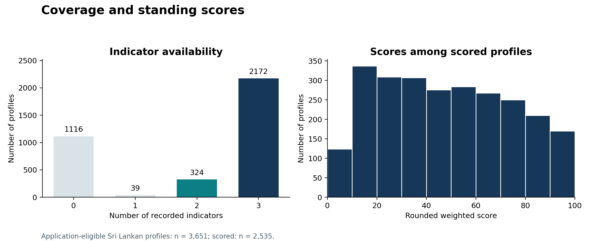
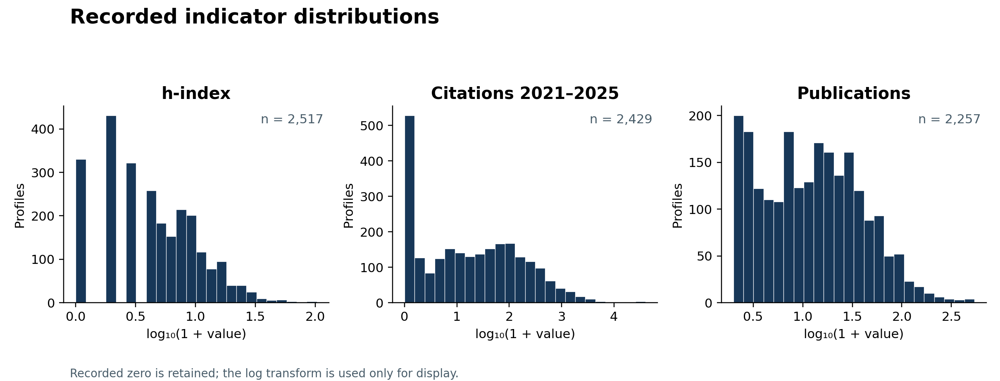
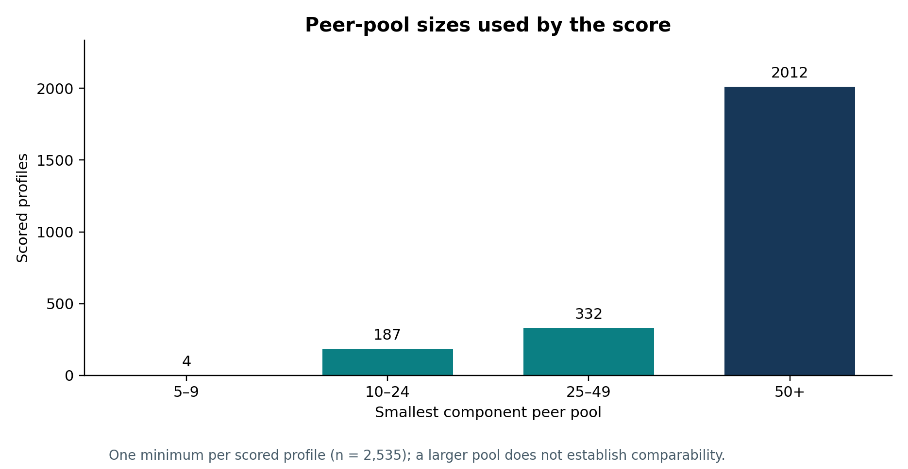
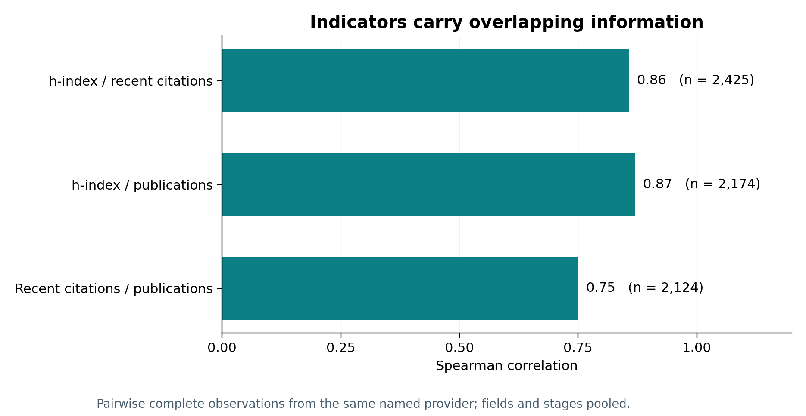
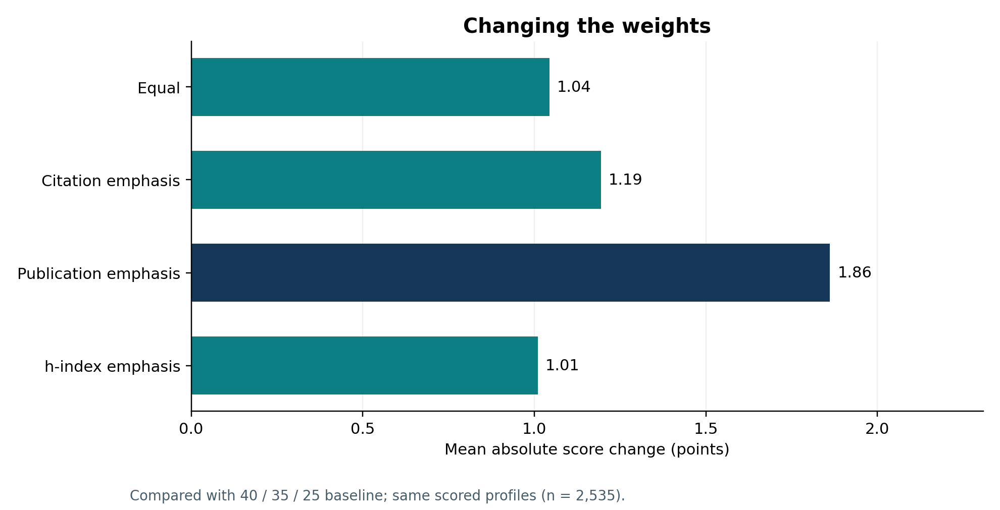
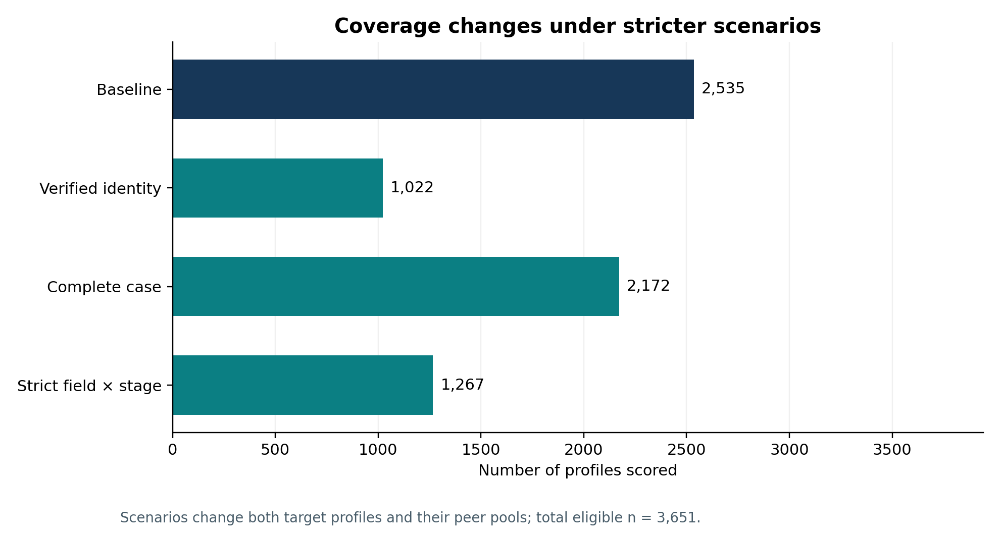

# Research scoring: methodological evaluation

**Status:** ongoing methodological research · public working paper · not externally peer reviewed, validated or endorsed. **Version:** 1.0 (14 November 2026); live score implementation at base commit `ab0ad8ac72d7d668b66331c938e166a528048fd4`. The input snapshot is `partial-e191f13547` and includes pre-existing uncommitted public data changes; its exact hashes are in [manifest.json](data/manifest.json).

## Objective and questions

**Questions asked**

- What does the live score actually calculate?
- How complete and comparable are its inputs?
- How sensitive is it to weights and peer-group choices?
- Does the evidence support the intended interpretation?

The aim is to enable criticism and responsible interpretation, not to confirm a predetermined result.

**The live score**

- Weighted average of same-provider midrank percentiles: h-index (40%), citations 2021–2025 (35%), publications (25%). Weights are rescaled when a measure is missing.
- It is **not** the percentile of a composite score, and it cannot measure overall academic quality.
- It shows a limited position within collected bibliometric records, using broad and sometimes fallback peer groups. Exact conditions: [methodology](METHODOLOGY.md).

**What we tested**

- Named alternative weights and a simplex grid.
- Provider and identity restrictions, and completeness.
- Field and stage definitions, and minimum peer sizes.
- Winsorisation and a different tie rule.
- Results are cross-checked against the live scorer.

**Informed by** the [Leiden Manifesto](REFERENCES.md), [DORA's quantitative-indicator guidance](REFERENCES.md), the [OECD/JRC handbook](REFERENCES.md) and bibliometric literature. None of them approves this implementation or its weights.

## Findings

- **Coverage:** 3,651 eligible profiles, 2,535 scored. 1,748 profiles have no mapped field.
- **Weights:** swapping in the four alternative weightings keeps overall ranks very similar, but changes 134–221 score bands and moves individual scores by up to 8–15 points. A wider weight grid moves some scores more.
- **Overlap:** the three indicators are strongly correlated, so they partly count the same thing.
- **Other choices matter too:** broader peer groups, identity restrictions and the tie rule all change scores and coverage.
- **Conclusion:** the 40/35/25 weights remain an unvalidated assumption, and no optimal weighting can be identified from this data. The results hold for this collected sample and do not show the score is a fair or valid assessment of an individual.

### Key figures


*Figure 1. Number of available input indicators (all eligible profiles) and distribution of rounded scores among scored profiles. Zero is a recorded value, not missing.*


*Figure 2. Observed input values on a log10(1 + x) display scale; sample sizes exclude missing values.*


*Figure 3. The smallest scored component peer pool per profile. Group size alone does not establish comparability.*


*Figure 4. Spearman correlations across eligible same-provider pairs (h-index/recent citations 0.86, h-index/publications 0.87, recent citations/publications 0.75). The indicators overlap strongly.*


*Figure 5. Mean absolute score difference from the 40/35/25 baseline for the four named alternative weightings, on the same scored population.*


*Figure 6. Counts of scores under selected eligibility and peer-group scenarios. Scenarios differ in their selected populations, so counts are not directly comparable as a quality ranking.*

### Weight alternatives at a glance

| Scheme | h / recent / publications | Mean abs. change | Max abs. change | Band changes | Spearman ρ |
| --- | --- | ---: | ---: | ---: | ---: |
| Equal | 33.33 / 33.33 / 33.34 | 1.04 | 9 | 134 | 0.998 |
| Citation emphasis | 30 / 45 / 25 | 1.19 | 9 | 152 | 0.998 |
| h-index emphasis | 50 / 30 / 20 | 1.01 | 8 | 141 | 0.999 |
| Publication emphasis | 30 / 30 / 40 | 1.86 | 15 | 221 | 0.995 |

All 2,535 scored profiles, same peer pools, rounded scores. Aggregate rank correlation is high, but individual scores and bands still move. These are sensitivity ranges, not confidence intervals. Every number is produced by `scripts/analyze.py` (see [RESULTS.md](RESULTS.md) for the full tables).

Detailed tables, scenario definitions, captions and qualifications: [RESULTS.md](RESULTS.md), [METHODOLOGY.md](METHODOLOGY.md), [LIMITATIONS.md](LIMITATIONS.md), [REFERENCES.md](REFERENCES.md). No live algorithm or published score is changed by this study. See also the [application score documentation](../../docs/STANDING_SCORE.md).

## Reproduce

From repository root, using Python 3.9.6 and Node 22.23.2 (the run recorded here):

```sh
python3 -m venv /tmp/lanka-score-venv
/tmp/lanka-score-venv/bin/pip install -r research/scoring-validation/requirements.txt
npm ci
MPLCONFIGDIR=/tmp/lanka-score-mpl /tmp/lanka-score-venv/bin/python research/scoring-validation/scripts/analyze.py
./node_modules/.bin/esbuild research/scoring-validation/scripts/live-check.ts --bundle --platform=node --format=esm --outfile=/tmp/lanka-score-live-check.mjs
node /tmp/lanka-score-live-check.mjs research/scoring-validation/data/snapshot.csv /tmp/lanka-score-live.json
MPLCONFIGDIR=/tmp/lanka-score-mpl /tmp/lanka-score-venv/bin/python research/scoring-validation/scripts/crosscheck.py /tmp/lanka-score-live.json
/tmp/lanka-score-venv/bin/python research/scoring-validation/scripts/report.py
MPLCONFIGDIR=/tmp/lanka-score-mpl /tmp/lanka-score-venv/bin/python -m unittest discover -s research/scoring-validation/tests
```

**Outputs:** aggregate tables in `results/` and figures in `figures/`. The cross-check against the live scorer reports 3,651 profiles checked, 0 mismatches. Per-record scores are written only to `/tmp`.

> **Restricted input.** The record-level file `data/snapshot.csv` is **not published**. It has no names, IDs or links, but institution, rank and metrics together could be matched to public profiles. Its SHA-256 is in [manifest.json](data/manifest.json).
>
> **Reproducibility limit:** without that file you can read and test the scripts and see every aggregate result, but cannot rerun the pipeline end to end. A researcher with a legitimate need can request it from the maintainer. `snapshot.py` cannot rebuild it from a clean checkout, because the public data had uncommitted changes when it was captured.
