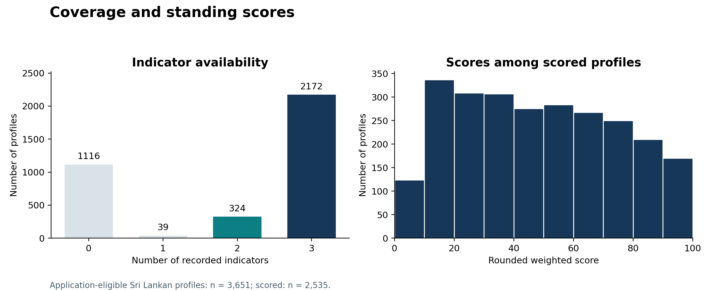
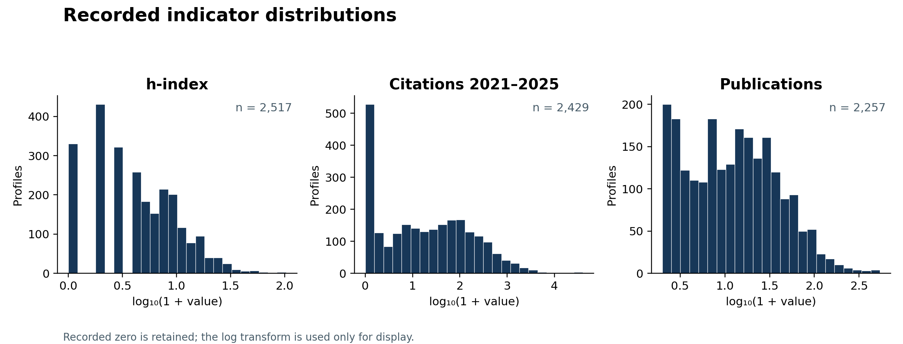
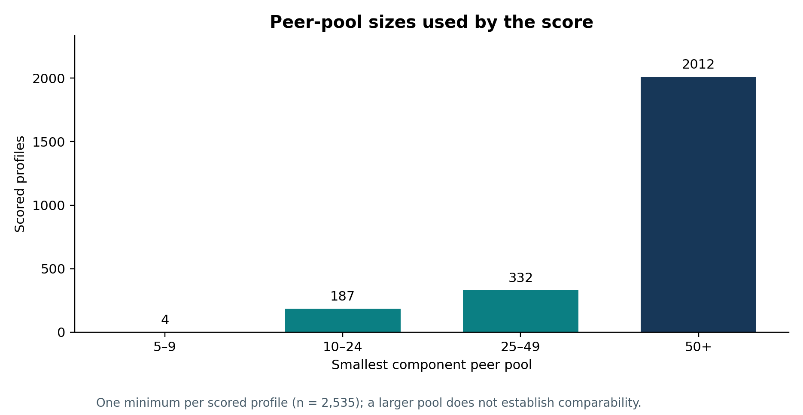
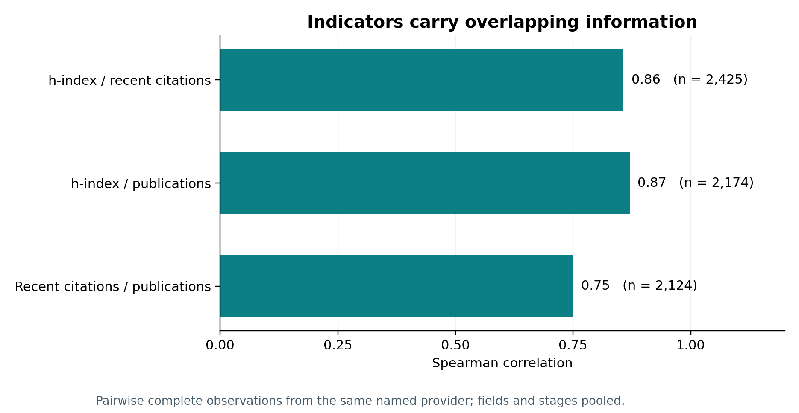
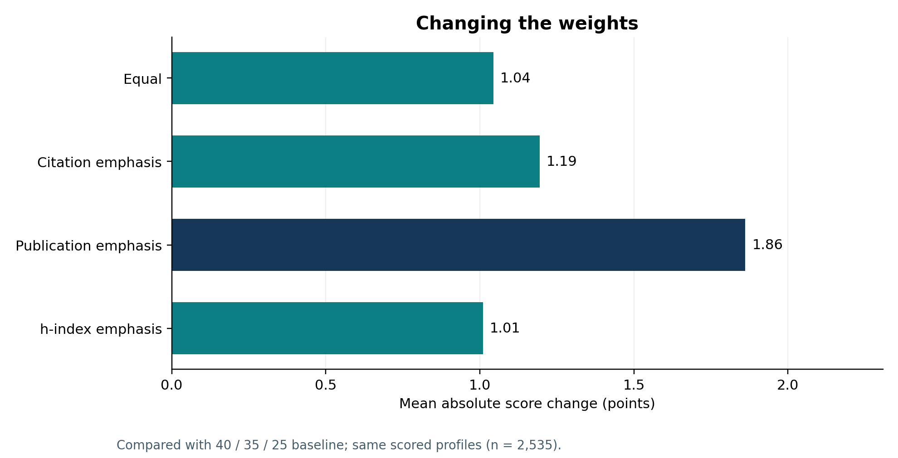
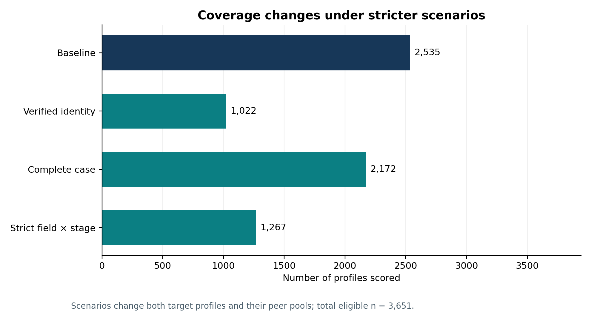

# Empirical results

Snapshot **partial-e191f13547**, 3,651 application-eligible Sri Lankan records; input hashes and dirty-tree status are in [manifest](data/manifest.json). This is a convenience collection, not a representative sample. The peer pools and results below are Sri Lankan only.

## Coverage and quality

2,535 profiles received a score: 2,368 standard and 167 indicative. 1,116 were not scored. Of scores, 2,121 use three indicators, 375 use two, and 39 use one. On input, 2,172 records had all three indicators, 1,116 had none, and 1,065 satisfied the application's broad identity proxy.
1,748 profiles have an unmapped field and 280 have an unknown or other stage. Among scored profiles, 1,296 used field × stage, 1,109 stage alone, 74 field across stages, and 56 the full collection. Mixed-provider fallback was used for 0 scores. A field × stage label is not proof of scientific comparability.
Across the full public input before exclusions: 0 duplicate ID keys, 10 repeated preferred research-profile keys, and 2 repeated normalized-name/institution keys. These are candidate issues, not confirmed duplicate people: multi-affiliations and same names are possible. Some records lack profile links, so these checks cannot rule out duplicates.

*Figure 1. Number of available input indicators (all eligible profiles) and distribution of rounded scores among scored profiles. Zero is a recorded value, not missing.*

*Figure 2. Observed input values on a log₁₀(1 + x) display scale; sample sizes exclude missing values.*

*Figure 3. The smallest scored component peer pool per profile. Group size alone does not establish comparability.*

## Indicator relationships

| Pair | Same-provider pairs | Spearman ρ | Kendall τ-b |
| --- | ---: | ---: | ---: |
| hIndex / recentCitations | 2425 | 0.8571 | 0.7289 |
| hIndex / publications | 2174 | 0.8703 | 0.7208 |
| recentCitations / publications | 2124 | 0.7504 | 0.5774 |

Pairwise samples require a common named provider (Google Scholar, ResearchGate or OpenAlex). These correlations combine fields and stages; they are descriptive and do not establish independent or causal contributions. High correlations suggest overlapping information, not an empirically optimal weighting.

*Figure 4. Spearman correlations across eligible same-provider pairs. Sample sizes differ by pair.*

## Weight sensitivity

All comparisons use the same scored people, their original peer pools, available components and rounded scores. Rank correlations are descriptive over this heterogeneous collection, not a common-peer ranking. Reversed pairs count strictly opposite orderings before and after reweighting, excluding ties in either score; those pairs can come from different peer groups.

| Scheme | Weights h / recent / publications | n | Mean absolute change | Median absolute change | Maximum absolute change | Band changes | Reversed pairs | Spearman ρ | Kendall τ-b |
| --- | --- | ---: | ---: | ---: | ---: | ---: | ---: | ---: | ---: |
| baseline | 40 / 35 / 25 | 2535 | 0.0 | 0.0 | 0 | 0 | 0 | 1.0 | 1.0 |
| citation_emphasis | 30 / 45 / 25 | 2535 | 1.194 | 1.0 | 9 | 152 | 35664 | 0.99769 | 0.96929 |
| equal | 33.33 / 33.33 / 33.34 | 2535 | 1.044 | 1.0 | 9 | 134 | 28986 | 0.99826 | 0.97368 |
| h_index_emphasis | 50 / 30 / 20 | 2535 | 1.01 | 1.0 | 8 | 141 | 24602 | 0.99857 | 0.97653 |
| publication_emphasis | 30 / 30 / 40 | 2535 | 1.862 | 1.0 | 15 | 221 | 68055 | 0.99469 | 0.94802 |

A 0.1-step positive-weight simplex grid contains 36 configurations. Mean absolute changes range from 0.806 to 6.809 points, and the largest individual absolute change is 40 points. See [grid](results/weight_grid.csv) and [stage/field breakdowns](results/weight_segments.csv). No optimisation target or ground truth establishes a preferred weight.

*Figure 5. Mean absolute difference from the baseline for the four named alternatives, on the same scored population.*

## Other sensitivity experiments

| Scenario | Scored | Common n | Mean absolute change | Median absolute change | Maximum absolute change | Band changes | Spearman ρ | Kendall τ-b |
| --- | ---: | ---: | ---: | ---: | ---: | ---: | ---: | ---: |
| complete_case | 2172 | 2172 | 0.8 | 0.0 | 30 | 81 | 0.99676 | 0.97304 |
| minimum_20 | 2535 | 2535 | 0.37 | 0.0 | 31 | 47 | 0.9959 | 0.98459 |
| minimum_30 | 2535 | 2535 | 0.622 | 0.0 | 31 | 77 | 0.99367 | 0.9746 |
| provider_Google_Scholar | 1029 | 1029 | 0.314 | 0.0 | 31 | 12 | 0.99579 | 0.98732 |
| provider_OpenAlex | 1498 | 1498 | 0.0 | 0.0 | 0 | 0 | 1.0 | 1.0 |
| same_provider_only | 2535 | 2535 | 0.0 | 0.0 | 0 | 0 | 1.0 | 1.0 |
| stage_only | 2535 | 2535 | 3.006 | 0.0 | 31 | 363 | 0.9818 | 0.90604 |
| strict_field_stage | 1267 | 1267 | 0.0 | 0.0 | 0 | 0 | 1.0 | 1.0 |
| upper_ecdf | 2535 | 2535 | 4.735 | 3.0 | 28 | 599 | 0.98959 | 0.93313 |
| verified_identity | 1022 | 1022 | 3.984 | 3.0 | 29 | 178 | 0.97707 | 0.88498 |
| winsor_95 | 2535 | 2535 | 0.061 | 0.0 | 5 | 1 | 0.99998 | 0.99921 |

Differences are calculated only on profiles scored in both scenarios; scored counts show selection effects. Raising the standard threshold to 20 or 30 retains the 5-person indicative fallback, so it is not an enforcement test of those minima. Strict field × stage disallows all fallbacks and requires two indicators, including h-index or recent citations. Complete-case and verified-only runs change both eligible targets and peer pools. Provider-only runs discard other providers, without imputing. The upper empirical CDF assigns ties their upper rank; winsorisation caps each peer pool at its 95th percentile and is a sensitivity intervention, not evidence that extremes are wrong. These are scenario ranges, not confidence intervals.

*Figure 6. Counts of scores under selected eligibility and peer-group scenarios. Scenarios differ in their selected populations.*

## Dates, coverage and interpretability

For the h-index, recent citations and publications, respectively, 22 observations each have no measurement date; the rest have recorded months in October or November 2026. These are evidence dates and do not independently verify a citation window. [Aggregated counts by institution, field and stage](results/segments.csv) suppress groups smaller than five; [machine-readable results](results/summary.json) provide provider and date distributions. The 2021–2025 label is fixed, while providers and evidence dates differ.

The study found no independent reference criterion capable of validating research quality or assessing fairness. The large observed correlations and aggregate rank stability cannot establish construct validity or justify individual evaluation. Publication and citation metrics may omit books, local-language work, practice-oriented scholarship and unindexed work.

## Calculation check

The independent reconstruction was compared with the actual TypeScript scorer on all 3,651 application-eligible profiles: [cross-check result](results/production_crosscheck.json). This checks computation on this snapshot, not the correctness of source identities, coverage, or the assessment construct. See [methodology](METHODOLOGY.md) and [limitations](LIMITATIONS.md).
